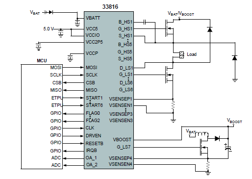

# Přehled projektu

`STM32H7-MC33816` je firmware a projekt pro CubeMX/CubeIDE k budiči vstřikovačů paliva **MC33816** od NXP. Řídicí deskou je **NUCLEO-H753ZI** (STM32H753ZI), která komunikuje přes SPI s vyhodnocovací deskou **KIT33816FRDMUG**. Slouží jako referenční platforma pro vývoj a testování algoritmů řízení vstřikování.

MC33816 nabízí konfiguraci přes SPI, buzení vstřikovačů v režimu peak-and-hold, pokročilou diagnostiku a integrované ochrany. STM32H7 zajišťuje SPI master, externí hodiny, startovací signály vstřikovačů a analogové měření.

# Dokumentace

Repozitář obsahuje v adresáři `Documents/`:

- schéma a uživatelský manuál NUCLEO-H753ZI (UM2407)
- uživatelskou příručku KIT33816FRDMUG
- datasheet MC33816
- schéma propojení Nucleo desky a sady

# Zapojení (NUCLEO-H753ZI -> KIT33816FRDMUG)

## Rozhraní SPI

| Signál | Pin STM32 | Pin sady | Poznámka |
|---|---|---|---|
| SPI_MOSI | `PA7` (SPI1_MOSI) | MOSI | master out |
| SPI_MISO | `PA6` (SPI1_MISO) | MISO | master in |
| SPI_SCK | `PA5` (SPI1_SCK) | SCK | doplnit pull-down 2k7 |
| SPI_CS | `PD14` | CS | aktivní v log. 0, softwarové řízení |

## Řídicí a stavové signály

| Signál | Pin STM32 | Pin sady | Poznámka |
|---|---|---|---|
| MC_RST | `PA4` | RESET | reset, aktivní v log. 0 |
| MC_DRV | `PB4` | DRV_EN | povolení budiče |
| MC_IRQ | `PE7` | IRQ | přerušení, sestupná hrana |
| MC_FLAG0 | `PG14` | FLAG0 | stavový příznak |
| MC_FLAG1 | `PF5` | FLAG1 | stavový příznak |
| MC_FLAG2 | `PF4` | FLAG2 | stavový příznak |
| MC_FLAG3 | `PG12` | FLAG3 | stavový příznak |

## Hodiny, ladění a analogové vstupy

| Signál | Pin STM32 | Pin sady | Poznámka |
|---|---|---|---|
| MC_CLK | `PF6` (TIM16_CH1) | CLK | externí hodiny pro MC33816 |
| MC_DBG | `PE8` | DEBUG | ladicí signál |
| MC_OA_1 | `PA0` (ADC1_INP16) | OA_OUT1 | výstup op. zesilovače 1 |
| MC_OA_2 | `PA1` (ADC1_INP17) | OA_OUT2 | výstup op. zesilovače 2 |

Výstupy MC33816 mají úroveň 5 V, vstupy ADC STM32H7 snesou 3,3 V, proto `MC_OA_1` a `MC_OA_2` vyžadují napěťový dělič (5 V na 3 V).

## Startovací signály vstřikovačů

| Signál | Pin STM32 | Pin sady |
|---|---|---|
| MC_START1 | `PB9` | START1 |
| MC_START2 | `PB15` | START2 |
| MC_START3 | `PC7` | START3 |
| MC_START4 | `PB8` | START4 |
| MC_START5 | `PB12` | START5 |
| MC_START6 | `PC6` | START6 |

Propojte zemní vodiče obou desek. Sada potřebuje vlastní externí napájení pro výkonové budiče vstřikovačů.

# Konfigurace firmware

Podle `STM32H7-MC33816.ioc`:

- MCU `STM32H753ZITx`, Cortex-M7, `SYSCLK = 480 MHz`, `HCLK = 240 MHz`
- SPI1 master, 8 bitů, prescaler `/8`, druhá hrana hodin (`SPI_PHASE_2EDGE`)
- ADC1/ADC2 pro výstupy op. zesilovačů, TIM16 pro hodiny MC33816, TIM2/TIM5 jako časovače
- FreeRTOS s FPU, kontrolou přetečení zásobníku a statistikami běhu
- Ethernet s LwIP (moduly `shell`, `ntp`/`sntp`, `ping`, `perf`), mbedTLS, USB device, RTC, RNG, CRC, CRYP a HASH

# Struktura repozitáře

- `Core/` - zdrojové kódy aplikace (`main.c`, `freertos.c`, `adc.c`, `rtc.c`, `debug.c`, `dwt_delay.c`)
- `Drivers/` - HAL, CMSIS a BSP
- `LWIP/`, `MBEDTLS/`, `Middlewares/` - síťový a bezpečnostní stack
- `USB_DEVICE/` - USB device stack
- `web/` - webové soubory obsluhované vestavěným HTTP serverem
- `Documents/` - schémata, manuály a datasheety

# Sestavení, nahrání a test

1. Naklonujte `https://github.com/CodElecCz/STM32H7-MC33816`
2. Otevřete `STM32H7-MC33816.ioc` nebo projekt importujte do STM32CubeIDE
3. Podle potřeby vygenerujte kód v CubeMX a sestavte Debug nebo Release
4. Nahrajte přes ST-LINK pomocí přiložených `.launch` konfigurací
5. Zapojte desky podle popisu výše a zkontrolujte SPI a úrovně signálů

Před připojením hardwaru ověřte přiřazení pinů podle souboru `.ioc` a časování SPI podle datasheetu MC33816.

# Zástupné obrázky

