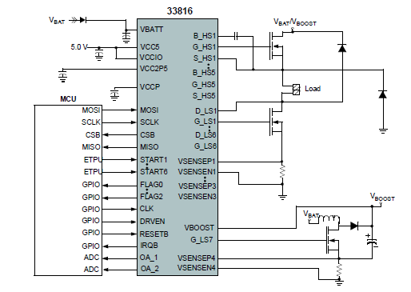

# Project overview

`STM32H7-MC33816` is firmware and a CubeMX/CubeIDE project for the **MC33816** fuel injector driver from NXP. The control board is a **NUCLEO-H753ZI** (STM32H753ZI) which talks to the **KIT33816FRDMUG** evaluation board over SPI. It serves as a reference platform for developing and testing injection control algorithms.

The MC33816 offers SPI configuration, peak-and-hold injector drive, advanced diagnostics and integrated protection. The STM32H7 provides the SPI master, the external clock, the injector start signals and the analog measurement.

# Documentation

The repository contains the following documents in `Documents/`:

- NUCLEO-H753ZI schematics and user manual (UM2407)
- KIT33816FRDMUG user guide
- MC33816 datasheet
- Connection schematic between the Nucleo board and the kit

# Hardware connections (NUCLEO-H753ZI -> KIT33816FRDMUG)

## SPI interface

| Signal | STM32 pin | Kit pin | Note |
|---|---|---|---|
| SPI_MOSI | `PA7` (SPI1_MOSI) | MOSI | master out |
| SPI_MISO | `PA6` (SPI1_MISO) | MISO | master in |
| SPI_SCK | `PA5` (SPI1_SCK) | SCK | add a 2k7 pull-down |
| SPI_CS | `PD14` | CS | active low, software controlled |

## Control and status signals

| Signal | STM32 pin | Kit pin | Note |
|---|---|---|---|
| MC_RST | `PA4` | RESET | reset, active low |
| MC_DRV | `PB4` | DRV_EN | driver enable |
| MC_IRQ | `PE7` | IRQ | interrupt, falling edge |
| MC_FLAG0 | `PG14` | FLAG0 | status flag |
| MC_FLAG1 | `PF5` | FLAG1 | status flag |
| MC_FLAG2 | `PF4` | FLAG2 | status flag |
| MC_FLAG3 | `PG12` | FLAG3 | status flag |

## Clock, debug and analog inputs

| Signal | STM32 pin | Kit pin | Note |
|---|---|---|---|
| MC_CLK | `PF6` (TIM16_CH1) | CLK | external clock for the MC33816 |
| MC_DBG | `PE8` | DEBUG | debug signal |
| MC_OA_1 | `PA0` (ADC1_INP16) | OA_OUT1 | op-amp output 1 |
| MC_OA_2 | `PA1` (ADC1_INP17) | OA_OUT2 | op-amp output 2 |

The MC33816 outputs are 5 V while the STM32H7 ADC inputs are 3.3 V, so `MC_OA_1` and `MC_OA_2` need a voltage divider (5 V to 3 V).

## Injector start signals

| Signal | STM32 pin | Kit pin |
|---|---|---|
| MC_START1 | `PB9` | START1 |
| MC_START2 | `PB15` | START2 |
| MC_START3 | `PC7` | START3 |
| MC_START4 | `PB8` | START4 |
| MC_START5 | `PB12` | START5 |
| MC_START6 | `PC6` | START6 |

Connect the grounds of both boards. The kit needs its own external supply for the high-current injector drivers.

# Firmware configuration

From `STM32H7-MC33816.ioc`:

- MCU `STM32H753ZITx`, Cortex-M7, `SYSCLK = 480 MHz`, `HCLK = 240 MHz`
- SPI1 master, 8-bit, prescaler `/8`, second clock edge (`SPI_PHASE_2EDGE`)
- ADC1/ADC2 for the op-amp outputs, TIM16 for the MC33816 clock, TIM2/TIM5 as timers
- FreeRTOS with FPU enabled, stack overflow checking and run-time statistics
- Ethernet with LwIP (including `shell`, `ntp`/`sntp`, `ping` and `perf` modules), mbedTLS, USB device, RTC, RNG, CRC, CRYP and HASH

# Repository structure

- `Core/` - application sources (`main.c`, `freertos.c`, `adc.c`, `rtc.c`, `debug.c`, `dwt_delay.c`)
- `Drivers/` - HAL, CMSIS and BSP
- `LWIP/`, `MBEDTLS/`, `Middlewares/` - network and security stack
- `USB_DEVICE/` - USB device stack
- `web/` - web assets served by the embedded HTTP server
- `Documents/` - schematics, manuals and datasheets

# Build, flash, and test

1. Clone `https://github.com/CodElecCz/STM32H7-MC33816`
2. Open `STM32H7-MC33816.ioc` or import the project into STM32CubeIDE
3. Regenerate code in CubeMX if needed and build Debug or Release
4. Flash through ST-LINK using the included `.launch` configurations
5. Wire the boards as described above and check the SPI and signal levels

Verify the pin assignment against the `.ioc` file before connecting hardware, and check the SPI timing against the MC33816 datasheet.

# Image placeholders

